<!-- Animated assets are generated by tools/build_assets.py. Numbers come from the results blocks of the two research repos (18 Oct 2026). -->

  <picture>
    <source media="(prefers-color-scheme: dark)" srcset="assets/hero-dark.svg">
    <source media="(prefers-color-scheme: light)" srcset="assets/hero-light.svg">
    
  </picture>

  
  
  
  

  <b>McGill MMA (2025)</b> &nbsp;·&nbsp; <b>SF State BS, Information Systems, magna cum laude (2023)</b> &nbsp;·&nbsp; Based in Canada 
  Open to roles across Canada in AI and ML engineering, applied and decision science, data and analytics engineering, technical and AI product management, and solutions engineering.

 

## Featured research

Two studies built this month, both public at v0.1.0, both with a protocol frozen before any data was collected. Click a card to open the repository.

<a href="https://github.com/Agent007repo/trusttrace">
  <picture>
    <source media="(prefers-color-scheme: dark)" srcset="assets/trusttrace-dark.svg">
    <source media="(prefers-color-scheme: light)" srcset="assets/trusttrace-light.svg">
    
  </picture>
</a>

  <a href="https://github.com/Agent007repo/trusttrace"><b>Repository</b></a> &nbsp;·&nbsp;
  <a href="https://github.com/Agent007repo/trusttrace/blob/main/paper/report.pdf">Report (PDF)</a> &nbsp;·&nbsp;
  <a href="https://github.com/Agent007repo/trusttrace#results">Results</a> &nbsp;·&nbsp;
  <a href="https://github.com/Agent007repo/trusttrace/blob/main/DEVIATIONS.md">Every deviation, dated</a>

> A typed metamodel links eight stakeholder roles to 40 requirements, decision records, components and executed tests. A feasibility pilot then asks whether small local models can extract obligations with exact evidence. Guided prompting looked better for Mistral-7B (0.86 to 0.91) but not for Qwen2.5-1.5B, and with 10 texts that is a direction to test, not a finding.

 

<a href="https://github.com/Agent007repo/continuum-bench">
  <picture>
    <source media="(prefers-color-scheme: dark)" srcset="assets/continuumbench-dark.svg">
    <source media="(prefers-color-scheme: light)" srcset="assets/continuumbench-light.svg">
    
  </picture>
</a>

  <a href="https://github.com/Agent007repo/continuum-bench"><b>Repository</b></a> &nbsp;·&nbsp;
  <a href="https://agent007repo.github.io/continuum-bench/explorer.html">Interactive explorer</a> &nbsp;·&nbsp;
  <a href="https://github.com/Agent007repo/continuum-bench/blob/main/paper/report.pdf">Report (PDF)</a> &nbsp;·&nbsp;
  <a href="https://github.com/Agent007repo/continuum-bench/blob/main/DEVIATIONS.md">Every deviation, dated</a>

> Six quantised models on one Apple M1 Max, 450 questions in three domains, component power sampled every 200 ms. Model choice moved energy by about 19 times, "edge" was not automatically cheaper, and a routing cascade that looked like a 29% saving offline measured 23.8% live, below the 25% bar I set in advance. I report that as not supported.

 

## How I work

<picture>
  <source media="(prefers-color-scheme: dark)" srcset="assets/principles-dark.svg">
  <source media="(prefers-color-scheme: light)" srcset="assets/principles-light.svg">
  
</picture>

Both studies were built with AI coding assistance, disclosed in each repository. I set the questions, wrote the gold labels, ran every measurement on my own machine and made the go or no-go calls. Every table and number in the reports is generated by code from committed raw data, and every reference is resolved by a script.

## Before research: product and engineering

| When | Role | What it taught me |
| :--- | :--- | :--- |
| 2024 to 2025 | **Data Architect**, McGill capstone sponsored by BNP Paribas | Turning an ambiguous financial-services problem into data, model and validation requirements |
| 2023 to 2024 | **Product Manager**, HelloPM | Integrating a third-party LLM API with routing between course and support requests |
| 2023 | **Product Manager**, AKQA | Taking a zero-to-one product with ML-driven recommendations from discovery to launch |
| 2022 to 2023 | **Webmaster and Business Analyst**, SF State | Usability testing, analytics instrumentation and stakeholder requirements |

<b>Engineering projects</b> &nbsp;(click to expand)

 

| Project | What to inspect | Honest scope |
| :--- | :--- | :--- |
| [Autonomous PM Engine](https://github.com/Agent007repo/autonomous-pm-engine) | Feedback ingestion, retrieval, multi-agent review, FastAPI job endpoints, generated PRDs and roadmaps | Prototype. Human review required; persistent storage, access control and deployment remain production work. |
| [SCRI: Supply Chain Risk Intelligence](https://github.com/Agent007repo/SCRI-Supply-Chain-Risk-Intelligence-System) | Macro-data preparation, forecasting, anomaly detection, horizon comparison | Research notebook. Earlier metrics need a corrected rerun; event coverage is not reliable early warning. |
| [Sequence modelling](https://github.com/Agent007repo/Advanced-Text-Generation-with-RNNs-Shakespearean-Style) | RNN, LSTM and GRU text generation and evaluation | Coursework-scale experiment |
| [Causal inference](https://github.com/Agent007repo/Causal_Inference_Project-) | Campaign-effect estimation with refutation checks | Coursework-scale experiment |
| [Return prediction and portfolios](https://github.com/Agent007repo/Advanced-Stock-Return-Prediction-and-Portfolio-Optimization) | Model comparison and portfolio optimisation | Coursework-scale experiment |
| [Vaccination tweet analysis](https://github.com/Agent007repo/Vaccination-Tweet-Analysis) | NLP, sentiment and network analysis | Coursework-scale experiment |
| [Air-quality prediction](https://github.com/Agent007repo/Air_Quality_Random_Forest_Model_Project) | Supervised learning and error analysis | Coursework-scale experiment |

## Toolkit

  
  
  
  
  
  
  
  
  
  
  
  
  
  

Animations are plain CSS inside the SVGs and switch off if your system asks for reduced motion.

